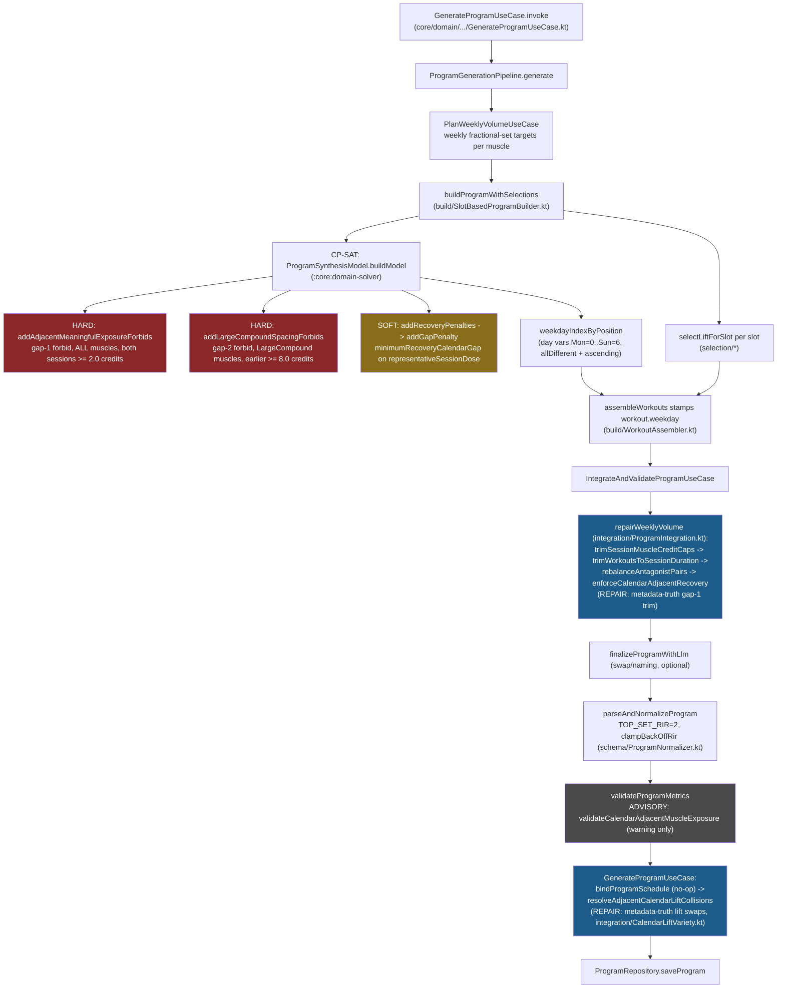

# Recovery-Scheduling Literature Alignment — Research & Plan

Status: **planning only** — no code changes proposed for direct merge from this document.
Scope: program-generation recovery scheduling in `:core:domain` and the solver
(`:core:domain-solver` at write time; migrated to `solver-python/` in STR-45/STR-46 —
recovery semantics preserved, Kotlin file paths historical).
Source-of-truth framework: additive recovery model (24h baseline + volume + lift-type + failure modifiers).

---

## 1. Executive summary

Stratum's recovery scheduling is **directionally aligned but structurally different** from the
literature model. Outcomes for the common cases land close to the target matrix (48h floor for
meaningful exposure everywhere, 72h for big movers at moderate-plus dose), but the implementation
classifies by **muscle name** instead of **movement stress**, uses a tiered lookup instead of an
additive baseline+modifier model, ignores RIR entirely, and enforces the same rules in **four
partially-duplicated places** (solver hard forbids, solver soft penalties, post-hoc set trims,
post-hoc lift swaps) plus one dead code path. The three highest-value changes are:

1. **Replace the two-class muscle taxonomy with a three-tier movement-stress classification**
   (isolation / upper compound / heavy axial) derived from data the pipeline already carries
   (`RpRepProfile`, movement pattern, `MAJOR_COMPOUND_PATTERNS`), so bench/row/OHP recover on a
   faster clock than squat/deadlift for the same muscle dose, and quad work from leg extensions
   stops being priced like squats.
2. **Restate `MuscleRecoveryReference` as an additive hours model** (baseline 24h + volume tier +
   lift-type tier, failure deferred) that maps to calendar gaps, and fix the volume-tier constants —
   today `MUSCLE_RECOVERY_MODERATE_DOSE = 8.0` is documented as "4–7 sets" but numerically gates the
   literature's **high** tier, and `MUSCLE_RECOVERY_HEAVY_DOSE = 12.0` is unreachable because
   `SESSION_MUSCLE_SET_CAP = 8` caps per-session credits below it.
3. **Unify all enforcement sites on that single reference function** and delete the dead
   `RecoveryScheduleOptimizer.kt` permutation path (which is also accidentally git-ignored by the
   `**/build/` pattern — it has never been committed).

The failure modifier is a justified deferral for top sets (normalization pins `TOP_SET_RIR = 2`),
but note one real 0-RIR exposure: `clampBackOffRir` forces **all non-major-compound back-off sets to
RIR 0**, so isolation back-offs are prescribed to failure today (§5.4).

---

## 2. Current-state architecture

### 2.1 Recovery decision path (verified)



### 2.2 Enforcement inventory (hard vs soft vs repair vs advisory vs dead)

| Tier | Where | Rule | Dose basis |
|------|-------|------|------------|
| **Hard** (solver forbid) | `ProgramSynthesisModel.addAdjacentMeaningfulExposureForbids` | No muscle with ≥ 2.0 credits (`MUSCLE_RECOVERY_MIN_SCHEDULING_DOSE`) on both of two calendar-adjacent days (incl. Sun→Mon wrap). Applies to **every** muscle, any specialization tier. | Solver pattern credits (`VolumeAllocationCoefficients`, catalog-averaged secondaries, SCALE=100) |
| **Hard** (solver forbid) | `ProgramSynthesisModel.addLargeCompoundSpacingForbids` | Gap-2 (48h) forbidden when the **earlier** day carries ≥ 8.0 credits (`MUSCLE_RECOVERY_MODERATE_DOSE`) of a `LargeCompound` muscle (Chest/Back/Quad/Hamstring/Glute). One-way lookback. | Solver pattern credits |
| **Soft** (solver objective) | `ProgramSynthesisModel.addGapPenalty` (slacks `rec_pri_*`/`rec_gen_*`, quadratic in shortfall, `RECOVERY_GAP_PENALTY_BASE = 80`, adjacent ×10, cap 10 000) | Shortfall vs `minimumRecoveryCalendarGap`, gated on both sessions' meaningful-exposure literals. | **`representativeSessionDose` = weekly aim ÷ session count** — *not* the solved per-session credit (see gap G7) |
| **Repair** (post-selection trim) | `ProgramIntegration.enforceCalendarAdjacentRecovery` (inside `repairWeeklyVolume`) | Trims sets (later day first, secondary contributors first, down to 1 set, lower anchors protected) until one adjacent day drops below 2.0 credits. **Gap-1 pairs only.** | Metadata truth (`computeWorkoutMuscleVolume`: primary 1.0/set, secondary 0.5/set) |
| **Repair** (post-normalization swap) | `CalendarLiftVariety.resolveAdjacentCalendarLiftCollisions` (called from `GenerateProgramUseCase`) | Swaps a lift on the later adjacent day when both days meaningfully stress the same muscle per lift metadata; also removes same-lift repeats on adjacent days. | Metadata truth |
| **Advisory** | `ProgramValidation.validateCalendarAdjacentMuscleExposure` | Warning `CALENDAR_ADJACENT_MUSCLE_EXPOSURE`; never blocks. | Metadata truth |
| **Dead** | `build/RecoveryScheduleOptimizer.kt` (`optimizeBuiltWorkoutSchedule`, `optimizeProgramRecoverySchedule`, `trimAdjacentPriorityTouchExposure`) + `ProgramSchedule.assignProgramSchedule` / `optimizeWorkoutWeekdayAssignment` + the penalty scoring in `MuscleSessionExposure.recoveryScheduleSummary` | Pre-CP-SAT weekday-permutation path. **Zero production callers** (only tests reference `assignProgramSchedule`). `RecoveryScheduleOptimizer.kt` is untracked and matched by the `.gitignore` line 5 pattern `**/build/` — it compiles locally but has never been committed. | Metadata truth / estimated doses |

> **Repo hygiene finding:** the source package `com/stratum/domain/program/generation/build/` is
> swallowed by `.gitignore`'s `**/build/`. `SlotBasedProgramBuilder.kt` and `WorkoutAssembler.kt`
> are tracked (added before or despite the pattern), but `RecoveryScheduleOptimizer.kt` is
> invisible to git. Any future file added to that package will silently not be committed.
> This needs a fix (negation rule or package rename) regardless of the recovery work.

### 2.3 How "dose" is computed (three coexisting models)

1. **Solver pattern credits** — `VolumeAllocationCoefficients.coeff(slot, muscle)`: 1.0 if the slot's
   `primaryMuscle` matches, else the **catalog-averaged** secondary credit for the slot's movement
   pattern from `computePatternSecondaryCredits` (`RpReferenceTables.kt`) — average over enabled
   lifts sharing the pattern of `SECONDARY_SET_CREDIT = 0.5` per tagged secondary muscle, falling
   back to the static `PATTERN_SECONDARY_MUSCLE_CREDITS` table. Integerized at `SCALE = 100`.
2. **Metadata truth** — `computeWorkoutMuscleVolume` (`validation/ProgramValidation.kt`): per
   selected lift, `PRIMARY_SET_CREDIT = 1.0`/set for each primary muscle, 0.5/set for each secondary
   not already primary. This is what the UI shows and what all post-hoc repairs enforce against.
3. **Template estimates** — `estimatedMuscleDosesForSessionType` (`split/MuscleSessionExposure.kt`):
   specialization-level heuristics (Specialize 8–10, Maintenance 5, MinimumVolume 3, cross-domain
   touch 2.0). Only feeds the dead permutation path today.

The solver-vs-metadata divergence (a selected lift tags a muscle the pattern average barely
credits, e.g. `barbell-sumo-deadlift` tagging Quad) is why the repair passes exist at all.

### 2.4 How lift type *could* be derived vs how it *is* used

Available signals, already plumbed to the solver and selection:

- `FilledSlot.repProfile` / `WorkoutSlotTemplate.repProfile`: `RpRepProfile`
  (`LowerFreeWeightCompound`, `LowerMachineOrUpperPress`, `UpperMachineOrPull`, `Isolation`).
- `classifyLiftRepProfile` (`prescription/RepRirPlanner.kt`): upgrades a slot to
  `LowerFreeWeightCompound` when the selected lift's pattern ∈ {`SquatPattern`, `HipHinge`} and
  `isLowerFreeWeightName` matches (`barbell|squat|deadlift|rdl|romanian`, excluding machine/smith).
- `MAJOR_COMPOUND_PATTERNS` (`reference/ProgramRules.kt`): squat/hinge + all presses + all pulls.
- `LiftContext.movementPattern(s)` and primary/secondary muscle tags per lift.

**Used for recovery today: none of these.** Recovery classification is
`muscleRecoveryClass(muscle: String)` (`reference/MuscleRecoveryReference.kt`) — a name switch:
Chest/Back/Quad/Hamstring/Glute → `LargeCompound`, everything else → `SmallIsolation`.

Concrete misclassifications this causes (from `core/data/src/main/assets/lifts/seed-lifts.json`):

| Lift | Primary muscle | Recovery class applied | Literature tier |
|------|----------------|------------------------|-----------------|
| `barbell-bench-press` | Chest | LargeCompound (72h-leaning) | Upper compound (36–48h+) |
| `leg-extension`-type isolations | Quad | LargeCompound | Isolation (24–48h) |
| `barbell-deadlift` | **LowerBack** (primary), Back/Quad/Ham/Glute secondary | LowerBack → `SmallIsolation` (48h) | Heavy axial (72h+) |
| `barbell-romanian-deadlift` | Hamstring | LargeCompound ✓ (by luck of muscle name) | Heavy axial ✓ |

The deadlift row is the sharpest: the heaviest axial lift in the catalog has its *primary* muscle in
the default 48h small-isolation tier.

### 2.5 Realized RIR per lift class (verified in `ProgramNormalizer.kt`)

| Set | Rule | Realized RIR |
|-----|------|--------------|
| Top set (any lift) | `TOP_SET_RIR` constant | **2** |
| Back-off, major compound pattern | `clampBackOffRir(true, proposed)` → clamp 1..2, default 2 | **1–2** |
| Back-off, everything else (all isolations) | `clampBackOffRir(false, _)` → **always 0** | **0 (failure)** |

`RP_REP_RIR_BANDS` (`RpReferenceTables.kt`) and `repRirForSlot` produce pre-normalization values,
but normalization overrides them — the bands are effectively advisory for RIR. So the prompt's
premise holds for **top sets and compound back-offs** (no planned failure), but isolation back-off
sets are planned at absolute failure today. RIR is **never** an input to any recovery computation.

---

## 3. Gap analysis vs literature

Calendar-gap convention: with one session per day, a gap of *n* day-indices ≈ 24 · *n* hours.
Literature hours → minimum gap: 24h→1, 48h→2, 72h→3, 96h→4.

| # | Literature rule | Current behavior | Severity | Recommended action |
|---|-----------------|------------------|----------|--------------------|
| G1 | Additive model: 24h baseline + volume + lift-type (+ failure) | Tiered lookup `minimumRecoveryCalendarGap(muscle, earlierDose, laterDose)` returning 0/2/3; no additive structure | Minor (structural) — outcomes mostly coincide at moderate tiers | Restate as additive hours internally; keep calendar-gap output (§4) |
| G2 | Three lift-type tiers (isolation / upper compound / heavy axial) | Two tiers by **muscle name**; bench=squat tier, leg-extension=squat tier, deadlift's LowerBack=isolation tier | **Meaningful** — the core fidelity gap | Introduce `LiftStressClass` derived from `RpRepProfile`/pattern (§4.2); price recovery per (muscle, dominant class) |
| G3 | Isolation, low volume (1–3 sets), 1–3 RIR → **24h** repeat allowed | Hard-forbidden: any muscle ≥ 2.0 credits on both adjacent days is a solver forbid + repair trim → effective 48h floor everywhere | Meaningful, but plausibly an **intentional conservative deviation** | Product decision (§8 Q1). If adopted: scope the adjacent forbid to exclude Isolation-class low-dose submaximal exposures |
| G4 | Volume tiers: low ≤3, moderate 4–7, high 8+ | Constants: `LIGHT=3.0` ✓, `MIN_SCHEDULING=2.0` (extra gate, fine), `MODERATE=8.0` labeled "4–7 sets" but gating the literature **high** boundary, `HEAVY=12.0` unreachable (`SESSION_MUSCLE_SET_CAP=8` caps session credits, so the isolation 72h branch is dead in practice) | **Meaningful** — the hard 72h compound forbid fires only at the high tier; moderate (4–7) heavy-axial days rely on the soft penalty; isolation never escalates past 48h | Rebase tiers on 3.0 / 7.0; make the heavy-axial 72h hard forbid fire at moderate (>7.0 → actually ≥4.0 credits, see §6); delete or repurpose `HEAVY=12.0` |
| G5 | High volume / failure → 96h+ tier | Max gap ever returned is 3 (72h) | Minor — 8+ set sessions at failure are not producible by the current prescription path (session muscle cap 8, RIR-2 top sets) | Add the +24h failure term to the model but leave it disabled/deferred; document |
| G6 | Failure (0 RIR) adds +24h | RIR is not an input anywhere in recovery; meanwhile isolation back-offs are realized at 0 RIR (§2.5) | Minor for compounds (no 0-RIR exposure); **worth a decision** for isolation back-offs | Either (a) accept: isolation moderate at 48h with 0-RIR back-offs is the one matrix row we knowingly violate (literature says 72h), or (b) change `clampBackOffRir` non-major floor to 1 RIR, or (c) wire the +24h adder. Recommend (b) — smallest change, aligns prescription instead of complicating recovery (§8 Q3) |
| G7 | Recovery debt is a function of the session actually performed | Solver soft penalties price gaps with `representativeSessionDose` = weekly aim ÷ session count, not the solved per-session credit; hard forbids do use solved credit vars | Meaningful (internal consistency) — soft tier can mis-tier a session the solver actually loaded heavily | Gate soft penalties on the same credit-tier literals the forbids use (`meaningfulExposureLiteral`, `moderateDoseLiteral`) instead of a static dose estimate |
| G8 | Debt is created by the **earlier** session's dose | `minimumRecoveryCalendarGap` uses `maxOf(earlier, later)` peak + a `touchInvolved` branch, so a later heavy session retroactively extends the requirement | Minor — conservative, and deliberately protects "light touch → heavy push next day" ordering | Keep as an explicit, documented deviation: required gap = f(earlier session), plus a separate readiness rule for the later session if desired |
| G9 | One authoritative model | Four live enforcement sites + one dead path + advisory validation, with three dose models | Meaningful (maintenance) | All sites call the same reference function (§4); delete `RecoveryScheduleOptimizer.kt` + `assignProgramSchedule` permutation path; fix the `**/build/` gitignore trap |

### 3.1 Explicit evaluations requested

**Is 24h high-frequency isolation desirable/feasible?** Feasible only narrowly. Split templates
(`slots/SessionTypeCatalog.kt`) and weekly aims mean a muscle trained on adjacent days almost always
carries ≥ 2.0 credits per session (the solver's `MIN_SETS_PER_ACTIVE_SLOT = 2` makes *every active
slot* recovery-visible by design). Real beneficiaries are arm/calf specialization on 5–6-day splits
(the exact scenarios in `FiveDayArmCalfMtwfsRecoveryTest` and `ScheduleRecoveryIntegrationTest`),
where the tight calendar currently produces "unavoidable violations" the tests tolerate
(`priorityViolations.size <= 6`). Allowing a sanctioned 24h lane for Isolation-class, ≤3-credit,
submaximal exposure would convert those tolerated violations into intended behavior. Recommendation:
**adopt, behind the three-tier model, as the last phase** — it is the only phase that relaxes a hard
constraint (§7 phase 5).

**Should upper compounds recover faster than squats/deadlifts at the same muscle dose?** Yes — this
is both the literature position and the position of the file's own doc comment
(`MuscleRecoveryReference.kt` lines 15–28 cites Korak 2015: bench 70% / deadlift 60% vs isolation
90% at 48h). The current *code* cannot express it because Chest and Quad share one class. Under the
matrix: upper compound moderate = 48–72h (gap 2 acceptable), heavy axial moderate = 72h (gap 3).
Today both get soft-72h at ≥3.0 credits; only heavy-axial should.

**Dose thresholds 3/7/8 vs current 2/3/8/12?** Keep `MIN_SCHEDULING = 2.0` as the *meaningful
exposure* gate (it's a scheduling-noise filter, not a literature tier, and both the solver literal
and every repair depend on it). Rebase the tiers to literature: low ≤ 3.0, moderate 3.0–7.0, high
> 7.0 (in fractional credits). Delete `HEAVY = 12.0` (unreachable). Note honestly: fractional credits
≠ hard sets (a 6-set pull day = 3.0 bicep credits), so thresholds are calibrated in credits and the
mapping to the literature's "sets" is approximate by design — document this in the reference file.

**Is the failure modifier worth modeling?** Not for top sets — normalization pins RIR 2 and there is
no realized 0-RIR top-set exposure on any compound. Document as **intentional deferral** with one
carve-out decision: isolation back-offs at 0 RIR (G6). If prescription keeps 0-RIR isolation
back-offs, the isolation-moderate row is 72h per literature and we consciously keep 48h; prefer
changing the prescription (back-off floor 1 RIR for non-major) over adding a failure input.

---

## 4. Proposed recovery model (single authority in `:core:domain`)

### 4.1 Formula

New file content for `reference/MuscleRecoveryReference.kt` (replacing the current lookup; names
final at implementation time):

```kotlin
enum class LiftStressClass { Isolation, UpperCompound, HeavyAxial }

// Additive model, hours from end of earlier session to baseline force production.
const val RECOVERY_BASELINE_HOURS = 24
const val RECOVERY_VOLUME_MODERATE_HOURS = 24   // 4–7 hard-set-equivalents
const val RECOVERY_VOLUME_HIGH_HOURS = 48       // 8+
const val RECOVERY_CLASS_UPPER_COMPOUND_HOURS = 24  // literature 12–24; take upper bound
const val RECOVERY_CLASS_HEAVY_AXIAL_HOURS = 48     // literature 36–48; take upper bound
const val RECOVERY_FAILURE_HOURS = 24               // deferred: minRealizedRir wiring is phase 6+

// Volume tiers in fractional credits (primary 1.0 / secondary 0.5) — approximate hard sets.
const val MUSCLE_RECOVERY_MIN_SCHEDULING_DOSE = 2.0  // unchanged: meaningful-exposure gate
const val MUSCLE_RECOVERY_LOW_DOSE_MAX = 3.0         // was MUSCLE_RECOVERY_LIGHT_DOSE
const val MUSCLE_RECOVERY_MODERATE_DOSE_MAX = 7.0    // was 8.0 (mislabeled)

fun recoveryHours(
    earlierDose: Double,            // session fractional credits for the muscle
    stressClass: LiftStressClass,   // dominant class among the session's contributors (§4.3)
    minRealizedRir: Int? = null,    // deferred; pass null everywhere in v1
): Int {
    if (earlierDose < MUSCLE_RECOVERY_MIN_SCHEDULING_DOSE) return 0
    val volume = when {
        earlierDose <= MUSCLE_RECOVERY_LOW_DOSE_MAX -> 0
        earlierDose <= MUSCLE_RECOVERY_MODERATE_DOSE_MAX -> RECOVERY_VOLUME_MODERATE_HOURS
        else -> RECOVERY_VOLUME_HIGH_HOURS
    }
    val type = when (stressClass) {
        LiftStressClass.Isolation -> 0
        LiftStressClass.UpperCompound -> RECOVERY_CLASS_UPPER_COMPOUND_HOURS
        LiftStressClass.HeavyAxial -> RECOVERY_CLASS_HEAVY_AXIAL_HOURS
    }
    val failure = if (minRealizedRir == 0) RECOVERY_FAILURE_HOURS else 0
    return RECOVERY_BASELINE_HOURS + volume + type + failure
}

/** Hours → minimum calendar day-index gap (Mon=0..Sun=6; wrap gap = (later - earlier + 7) % 7). */
fun minimumRecoveryCalendarGap(
    earlierDose: Double,
    stressClass: LiftStressClass,
    minRealizedRir: Int? = null,
): Int = ceil(recoveryHours(earlierDose, stressClass, minRealizedRir) / 24.0).toInt()
```

Matrix verification (all rows reproduce the target table):

| Class | Dose (credits) | RIR | Hours | Gap | Literature |
|-------|----------------|-----|-------|-----|------------|
| Isolation | ≤3 | 1–3 | 24 | 1 | 24h ✓ |
| Isolation | 3–7 | 1–3 | 48 | 2 | 48h ✓ |
| Isolation | 3–7 | 0 | 72 | 3 | 72h ✓ (deferred) |
| UpperCompound | ≤3 | 1–3 | 48 | 2 | 36–48h ✓ |
| UpperCompound | 3–7 | 1–3 | 72 | 3 | 48–72h ✓ (upper bound) |
| HeavyAxial | ≤3 | 1–3 | 72 | 3 | 48–60h ✗ **conservative over-shoot** — see below |
| HeavyAxial | 3–7 | 1–3 | 96 | 4 | 72h ✗ over-shoot |
| HeavyAxial | 3–7 | 0 | 120 | 5 | 96h+ ✓ direction |

The upper-bound constants overshoot the heavy-axial rows because the literature's own adders
(36–48h type + 24h volume) exceed its own matrix values (72h) — the matrix rows are ranges, not
strict sums. **Calibrate the constants to hit the matrix, not the adders**: use
`RECOVERY_CLASS_HEAVY_AXIAL_HOURS = 36` and keep volume moderate at +12 for heavy axial, or simpler,
clamp: `min(recoveryHours, 96)` with heavy-axial-low special-cased to 48. Recommended concrete
calibration (hits every matrix row exactly at the conservative end while keeping the additive
shape):

| Class | low | moderate | high |
|-------|-----|----------|------|
| Isolation | 24h (gap 1) | 48h (gap 2) | 72h (gap 3) |
| UpperCompound | 48h (gap 2) | 72h (gap 3) | 72h (gap 3) |
| HeavyAxial | 48h (gap 2) | 72h (gap 3) | 96h (gap 4) |

i.e. implement the additive formula but assert these nine outputs as the golden contract in tests —
if the additive constants and the table ever disagree, the table wins. This is the "align to
outcomes without over-engineering" clause of the task.

### 4.2 Lift-type classification rules (hybrid: profile first, pattern fallback)

Priority order, applied per slot / per selected lift:

1. `RpRepProfile.LowerFreeWeightCompound` → **HeavyAxial**. Already computed by
   `classifyLiftRepProfile` from pattern ∈ {`SquatPattern`, `HipHinge`} + free-weight name check.
   Examples: `barbell-back-squat`, `barbell-deadlift`, `barbell-romanian-deadlift`,
   `barbell-sumo-deadlift`.
2. `RpRepProfile.Isolation` → **Isolation**. Examples: `barbell-curl` (ElbowFlexion),
   lateral raises (ShoulderAbduction), calf work (PlantarFlexion).
3. Remaining slots with pattern ∈ `MAJOR_COMPOUND_PATTERNS` (all presses and pulls, plus
   machine/smith squat-pattern and hinge lifts that failed the free-weight check) → **UpperCompound**
   for press/pull patterns; machine lower compounds (leg press, smith squat) are a judgment call —
   recommend **UpperCompound tier** (they lack axial loading; Korak's laggards were barbell lifts).
   Examples: `barbell-bench-press`, `barbell-incline-bench-press`, `barbell-rear-delt-row`, OHP.
4. Anything else → **Isolation** (conservative default is *not* needed here — unclassified patterns
   are single-joint by construction).

Session-level aggregation for muscle M (needed because the model prices a *muscle-session*, not a
lift): **dominant class = max class among lifts/slots contributing ≥ 1.0 credit to M in that
session**, ordered Isolation < UpperCompound < HeavyAxial. Sub-1.0 contributors (e.g. one compound's
0.5 secondary tag) don't escalate the class; total session dose still counts all credits. This keeps
the "a triceps set is a triceps set" total-credit gate for *whether* recovery applies, while the
*class* reflects what actually generated the mechanical/neurological stress.

Cross-domain touch volume: touch slots are `RpRepProfile.Isolation` by construction
(`CrossDomainTouchSlots.kt`), so touch exposure is Isolation-class — under the new model a 2-credit
touch needs only 24h before/after another isolation exposure, but a muscle whose *other* session is
compound-driven still inherits that session's class for that session's debt. The current special
rule "light touch still needs 48h before a high-volume push" (the `touchInvolved` branch) is
preserved by G8's earlier-session semantics applied in both directions at the enforcement site (the
later session's own forbid checks its predecessor's debt).

### 4.3 Calendar mapping and week wrap

Unchanged mechanics, already correct: day indices Mon=0..Sun=6
(`split/TrainingWeekdays.kt::trainingWeekdayIndices`), adjacency incl. Sun→Mon wrap
(`calendarAdjacentTrainingDayPairs`), general wrap gap `(later - earlier + 7) % 7` as used in
`ProgramSynthesisModel.addRecoveryPenaltiesForSessionPair` and `gapTwoDayPairs`. Gap-4 support (96h
tier) requires extending `gapTwoDayPairs` to a general `gapNDayPairs(n)` — same shape.

### 4.4 API shape and call-site migration

Replacement for the current `minimumRecoveryCalendarGap(muscle, earlierFractionalSets,
laterFractionalSets)`:

```kotlin
data class MuscleSessionStress(
    val fractionalSets: Double,
    val stressClass: LiftStressClass,
)

/** Minimum day-index gap after [earlier] before the muscle is meaningfully loaded again. */
fun minimumRecoveryCalendarGap(earlier: MuscleSessionStress): Int
```

- The `muscle: String` parameter disappears (classification moves from muscle name to stress class);
  `muscleRecoveryClass`/`MuscleRecoveryClass` are deleted.
- The `laterFractionalSets` parameter disappears from the *model*; the *enforcement sites* still
  gate on the later session's meaningfulness (≥ 2.0 credits) before applying the gap — same
  semantics as today's forbid literals, now stated once. A transitional adapter keeping the old
  3-arg signature (`max` of both doses, class looked up per session) ships in phase 1 so all call
  sites migrate incrementally.
- Callers to migrate: `ProgramSynthesisModel.addGapPenalty` (solver), `MuscleSessionExposure.
  recoveryGapPenaltyResult` (delete with dead path or migrate if retained),
  `ProgramIntegration.enforceCalendarAdjacentRecovery`, `CalendarLiftVariety.
  resolveMetadataMuscleExposure`, `ProgramValidation.validateCalendarAdjacentMuscleExposure`,
  and the tests listed in §6.

Architecture compliance: everything above lives in `:core:domain`
(`reference/MuscleRecoveryReference.kt` + a small `LiftStressClassification.kt` beside
`RepRirPlanner.kt`); `:core:domain-solver` continues to consume domain reference functions only
(it already imports `minimumRecoveryCalendarGap`, `muscleRecoveryClass`, and the dose constants).
No Room schema is touched — recovery remains a pure generation-time computation.

---

## 5. Solver integration plan

Changes in `ProgramSynthesisModel` (`:core:domain-solver`), keeping the three-tier
hard/soft/repair architecture but re-scoping each tier:

| Constraint | Today | Proposed |
|-----------|-------|----------|
| `addAdjacentMeaningfulExposureForbids` (gap-1 hard) | All muscles, both sessions ≥ 2.0 credits | **Phases 1–4: unchanged.** Phase 5 (product-gated): exempt pairs where *both* sessions' exposure for the muscle is Isolation-class and ≤ 3.0 credits (new per-session `lowDoseIsolation` literal). Everything else keeps the 48h floor |
| `addLargeCompoundSpacingForbids` (gap-2 hard) | `LargeCompound` **muscles**, earlier ≥ 8.0 credits | Becomes `addHeavyAxialSpacingForbids`: gate on a per-session **HeavyAxial-class exposure literal** (any active slot with `repProfile == LowerFreeWeightCompound` contributing ≥ 1.0 credit to the muscle) instead of muscle name, threshold earlier ≥ 4.0 credits (moderate tier starts above low ≤ 3.0; use 4.0 in scaled credits ≈ literature 4–7 sets). Upper-compound muscles (Chest/Back via presses/pulls only) **drop out** of the gap-2 hard forbid — their 72h preference stays soft |
| New: gap-3 hard forbid | — | Only if phase 6 (failure/96h tier) ever lands; not in v1 |
| `addGapPenalty` soft penalties | `minimumRecoveryCalendarGap` on `representativeSessionDose` (static weekly-aim estimate), gated on both `meaningful` literals | Compute required gap per (session, muscle, class) using **tier literals on the actual credit var**: reuse `meaningfulExposureLiteral` / `moderateDoseLiteral` (renamed to the new thresholds) plus a class literal; enforce slack lower bounds per tier combination via `onlyEnforceIf`. Removes G7's static-dose mispricing. Keep quadratic shortfall weights and the priority/general split (`recoveryPriorityMuscles`) |
| Objective breakdown | `rec_pri_`/`rec_gen_`/`rec_adj_` slack prefixes | Unchanged names; `SynthesisObjectiveBreakdown.recoveryPenalty` keeps working |

Class literals are cheap: slot→class is a compile-time property of the slot universe (pattern +
`repProfile`), so "session has HeavyAxial exposure for M ≥ 1.0 credit" is a linear expression over
the already-existing slot vars, reified once per (session, muscle) — same memoization pattern as
`sessionMuscleCreditVar`.

Post-hoc repairs mirror the same rules on metadata truth:

- `enforceCalendarAdjacentRecovery` (`ProgramIntegration.kt`) gains the class lookup (per-lift
  `movementPattern` + `isLowerFreeWeightName` — same hybrid as §4.2 applied to `LiftContext`), and
  in a later phase extends from gap-1-only to "any pair violating the class-aware gap" (today a
  Mon+Wed pair of 8-credit squat days passes repair even though the solver would have forbidden it —
  the repair only reconciles gap-1).
- `resolveAdjacentCalendarLiftCollisions` (`CalendarLiftVariety.kt`) keeps its gap-1 scope (it fixes
  metadata drift, not scheduling) but adopts the shared meaningfulness + class gate so it can't swap
  away a low-dose isolation pairing that phase 5 deliberately allows.

---

## 6. Test & acceptance plan

Contract compliance: JUnit 5 + fakes per `contracts/UNIT_TESTING.md` (no MockK — all fixtures here
are hand-built `ProgramGenerationContext`s like `CalendarAdjacentRecoveryRepairTest` already uses);
domain tests in `core/domain/src/test/kotlin`, solver tests in `core/domain-solver/src/test/kotlin`.
Run: `./gradlew :core:domain:test :core:domain-solver:test detekt`.

### 6.1 Test matrix — literature rows → tests

| Matrix row | Unit level (`minimumRecoveryCalendarGap`) | Pipeline / solver level |
|------------|-------------------------------------------|--------------------------|
| Isolation, low, 1–3 RIR → 24h | `RecoveryModelTest.isolationLowDoseAllowsNextDay` (gap 1) | Phase 5 only: `IsolationDailyFrequencySynthesisTest.armSpecSixDayAllowsAdjacentLowDoseBicep` — asserts solver *may* place ≤3-credit bicep work on adjacent days without forbid infeasibility |
| Isolation, moderate → 48h | `RecoveryModelTest.isolationModerateDoseRequiresTwoDays` | Existing `ScheduleRecoveryIntegrationTest.fiveDayArmSpecScheduleAvoidsBackToBackTricepsWhenPossible` (tighten `tricepViolations <= 1` toward 0 as phases land) |
| Isolation, moderate, 0 RIR → 72h | `RecoveryModelTest.failureAdderDeferredReturnsSubmaximalGap` (documents deferral: asserts gap 2 with `minRealizedRir = null`, gap 3 with `0` once wired) | Deferred with G6 |
| Upper compound, low → 36–48h | `RecoveryModelTest.upperCompoundLowDoseRequiresTwoDays` | New `UpperCompoundSpacingSynthesisTest.benchTwiceWeeklyAllowsGapTwo` — Mon/Wed/Fri upper split must remain feasible with moderate chest dose (would fail today only if we wrongly hard-forbade gap-2 for Chest) |
| Upper compound, moderate → 48–72h | `RecoveryModelTest.upperCompoundModerateDoseRequiresThreeDays` (soft target) | Same test asserts the solver *prefers* gap ≥ 3 (objective comparison), does not require it |
| Heavy axial, low → 48–60h | `RecoveryModelTest.heavyAxialLowDoseRequiresTwoDays` | Existing `GluteAdjacentRecoverySynthesisTest.fourDayGluteSpecAvoidsAdjacentMeaningfulExposureInSolverAndPipeline` (keeps passing) |
| Heavy axial, moderate → 72h | `RecoveryModelTest.heavyAxialModerateDoseRequiresThreeDays` | New `HeavyAxialSpacingSynthesisTest.moderateSquatDayForbidsGapTwoRepeat` — Mon squat @ ≥4.0 quad credits (HeavyAxial class) forbids Wed quad; asserts vs the *new* 4.0 threshold (today only ≥8.0 triggers) |
| Heavy axial, moderate, 0 RIR → 96h+ | `RecoveryModelTest` gap-4 case behind the deferred flag | Deferred |
| Deadlift primary-muscle fix (G2) | `LiftStressClassificationTest.deadliftClassifiesHeavyAxialForLowerBack` | `HeavyAxialSpacingSynthesisTest.deadliftDayForbidsAdjacentLowerBackMeaningfulWork` |

### 6.2 Edge cases

- **Adjacent touch volume:** port `CalendarAdjacentRecoveryRepairTest` scenarios (already covers
  secondary-contributor trims, protected anchors, sub-threshold days, non-adjacent no-ops — note
  this test file is currently **uncommitted**, land it with the in-flight `ProgramIntegration.kt`
  diff first).
- **Secondary credit from compounds:** `GluteAdjacentRecoverySynthesisTest.
  squatPatternCreditsGluteLikeLiftMetadata` (exists); add a class-escalation case: session whose
  only Glute credit is 2.0 from squat secondaries → dose meaningful but class = HeavyAxial only if
  the ≥1.0-credit contributor is the squat (it is: 4 sets × 0.5) — assert dominant-class rule.
- **Specialization presets:** keep `ScheduleRecoveryIntegrationTest.
  sixDayArmAndCalfSpecLimitsCalfStreakAndRedirectsUpperVolume` and
  `FiveDayArmCalfMtwfsRecoveryTest` as regression canaries; their tolerance assertions
  (`<= 6` violations, streak `<= 3`) are the metrics phases 2–5 should ratchet down.
- **4–6 day splits + week wrap:** `GluteAdjacentRecoverySynthesisTest.
  sean5GluteSpecRespectsSundayMondayWrapAroundAdjacency` (exists); add a gap-2 wrap case
  (Sat heavy-axial → Mon) for the new forbid.
- **Solver-vs-metadata divergence:** `ProgramSynthesisAcceptanceTest.noAdjacentSameMuscleMetadata`
  (exists) stays the end-to-end truth check.

---

## 7. Phased PR plan

Ordered smallest-safe-first; each phase leaves all existing tests green unless stated.

| Phase | Content | Files | Risk / regression surface | Tests | Hard-forbid changes | Effort |
|-------|---------|-------|---------------------------|-------|---------------------|--------|
| **0** | Land in-flight work + hygiene: commit the current `ProgramIntegration.kt` diff with its `CalendarAdjacentRecoveryRepairTest`; fix `.gitignore` `**/build/` so `generation/build/` sources are trackable (e.g. `!**/src/**/build/` negation or rename package to `generation/assembly`); then **delete dead code**: `RecoveryScheduleOptimizer.kt`, `ProgramSchedule.assignProgramSchedule` permutation path + `optimizeWorkoutWeekdayAssignment`, penalty half of `MuscleSessionExposure.kt` (`recoveryScheduleSummary` consumers), `estimatedMuscleDosesForSessionType` if then unused | `.gitignore`, `generation/build/*`, `ProgramSchedule.kt`, `MuscleSessionExposure.kt`, affected tests (`ProgramScheduleOptimizationTest`, parts of `ProgramScheduleTest`) | Low on prod (code is dead); medium on tests that exercise the dead path — they get deleted or repointed | Existing suite; no new behavior | None | **S** |
| **1** | Additive model refactor, output-preserving: introduce `LiftStressClass`, `recoveryHours`, new `minimumRecoveryCalendarGap(MuscleSessionStress)`; keep a deprecated 3-arg adapter mapping muscle-name → class (Chest/Back → UpperCompound?, no — **adapter maps to current behavior**: Chest/Back/Quad/Ham/Glute → HeavyAxial, else Isolation, so outputs are bit-identical); fix constant naming (`MODERATE_DOSE_MAX = 7.0` introduced, old 8.0 kept temporarily for the solver forbid); golden table test asserting all nine §4.1 rows against the new API | `reference/MuscleRecoveryReference.kt`, new `prescription/LiftStressClassification.kt`, `MuscleRecoveryReferenceTest.kt` (+ new `RecoveryModelTest`, `LiftStressClassificationTest`) | Very low — adapter preserves outputs; only reference-layer churn | New unit tests; existing `MuscleRecoveryReferenceTest` rewritten against adapter | None | **S** |
| **2** | Class-aware solver: session-muscle class literals; migrate `addGapPenalty` off `representativeSessionDose` onto credit-tier literals (fixes G7); rename/re-gate `addLargeCompoundSpacingForbids` → `addHeavyAxialSpacingForbids` (class-gated, threshold 8.0 → 4.0 scaled credits); upper compounds leave the gap-2 hard tier | `ProgramSynthesisModel.kt`, `VolumeAllocationCoefficients.kt` (class exposure helper), solver tests | **Medium-high** — threshold 4.0 tightens lower-body spacing (3+ meaningful lower days/week may become infeasible on some 5–6-day layouts; needs acceptance-test sweep across `scenarioPayload` layouts and a fallback: if infeasible, threshold stays 8.0-hard with 4.0-soft) | `HeavyAxialSpacingSynthesisTest`, `UpperCompoundSpacingSynthesisTest`, rerun `ProgramSynthesisAcceptanceTest`, `GluteAdjacentRecoverySynthesisTest`, `sixDayPresetsSolveWithinBudget` (solve-time budget guard) | Gap-2 forbid re-scoped (tighter for heavy axial, removed for upper-compound-only muscles) | **M** |
| **3** | Class-aware repairs + validation on metadata truth: `enforceCalendarAdjacentRecovery` and `validateCalendarAdjacentMuscleExposure` adopt the class-aware gap (incl. gap-2 heavy-axial check post-selection); `resolveAdjacentCalendarLiftCollisions` adopts shared gates; delete the deprecated 3-arg adapter — all callers on the new API | `integration/ProgramIntegration.kt`, `integration/CalendarLiftVariety.kt`, `validation/ProgramValidation.kt`, their tests | Medium — repair trims can now fire on gap-2 pairs; over-trimming risk bounded by existing candidate scoring + anchors protection | Extend `CalendarAdjacentRecoveryRepairTest` with gap-2 heavy-axial and class-escalation cases | None (repair tier only) | **M** |
| **4** | Prescription fix for G6: `clampBackOffRir(false, _)` floor 0 → 1 (isolation back-offs no longer at failure), or explicit decision to keep 0 documented in the reference file | `reference/ProgramRules.kt`, `ProgramNormalizer` tests | Low — one constant path; changes generated programs' back-off RIR for isolations | Normalizer unit tests | None | **S** |
| **5** | *(Product-gated — §8 Q1)* 24h isolation lane: exempt low-dose Isolation-class pairs from the gap-1 hard forbid; ratchet down the tolerance assertions in `FiveDayArmCalfMtwfsRecoveryTest` / `ScheduleRecoveryIntegrationTest` | `ProgramSynthesisModel.kt` (`addAdjacentMeaningfulExposureForbids`), repair + swap gates from phase 3, solver tests | **High visibility** — first change that *allows* Mon→Tue same-muscle meaningful work anywhere in the product. ⚠ Flagged per task: this relaxes the currently-global adjacent forbid | `IsolationDailyFrequencySynthesisTest`; full acceptance sweep | Gap-1 forbid **relaxed** for Isolation-class ≤ 3.0-credit pairs only | **M** |
| **6** | *(Deferred, likely never)* failure modifier + 96h tier wiring (`minRealizedRir` input, gap-4 forbids) | reference + solver | High, low value while RIR is normalization-pinned | — | New gap-3/-4 tier | **L** |

Every phase: run `./gradlew :core:domain:test :core:domain-solver:test detekt` (maxIssues 0); phases
2+ also `./gradlew testDebugUnitTest` before merge per `AGENTS.md` §9.

---

## 8. Open questions (need product/design decision)

1. **Allow 24h isolation frequency at all?** (Phase 5.) The conservative 48h-everywhere floor is
   defensible UX (beginners can't over-schedule arms) and is what every current test encodes. The
   literature's "summary law" says low-volume 1–3-RIR isolation may repeat daily. Options:
   (a) keep 48h floor globally — document as intentional deviation; (b) allow 24h only for
   specialized muscles on 5–6-day splits; (c) allow universally per the model. Recommendation: (b).
2. **Upper-compound moderate dose: enforce 48h (hard) + prefer 72h (soft), or hard-72h like today’s
   effective behavior?** The plan proposes hard-48h/soft-72h (literature range 48–72h). This makes
   Mon/Wed/Fri bench-containing splits first-class instead of penalty-tolerated.
3. **Isolation back-off sets at 0 RIR** (`clampBackOffRir` non-major → 0): raise floor to 1 RIR
   (recommended, phase 4) or keep failure back-offs and accept the 48h-vs-72h matrix violation for
   moderate isolation days?
4. **Heavy-axial gap-2 hard threshold: 4.0 or 8.0 credits?** 4.0 matches the literature's moderate
   tier but risks solver infeasibility on dense lower-body layouts; 8.0 keeps today's feasibility
   with a soft 72h preference at 4.0–7.0. Phase 2 should measure infeasibility across the scenario
   presets before committing.
5. **Machine lower-body compounds** (leg press, smith squat, machine hinge): UpperCompound tier
   (recommended — no axial load) or HeavyAxial (conservative)?
6. **`.gitignore` fix strategy for `generation/build/`:** negation rule vs package rename
   (`generation/assembly`). Rename is cleaner but touches imports in ~3 files + tests.
7. **Unmapped muscles** (LowerBack, Trap, Forearm, Ab, Adductor): under the class model they no
   longer need a muscle-level default, but the *dominant-class* rule means LowerBack inherits
   HeavyAxial from deadlifts automatically. Confirm no muscle needs a manual override list.

---

## Appendix A — key file/function index

| Concern | Location |
|---------|----------|
| Gap lookup + dose constants | `core/domain/.../generation/reference/MuscleRecoveryReference.kt` (`minimumRecoveryCalendarGap`, `muscleRecoveryClass`, `MUSCLE_RECOVERY_*`) |
| Solver model + forbids + penalties | `core/domain-solver/.../solver/ProgramSynthesisModel.kt` (`addAdjacentMeaningfulExposureForbids`, `addLargeCompoundSpacingForbids`, `addGapPenalty`, `meaningfulExposureLiteral`, `moderateDoseLiteral`, `representativeSessionDose`) |
| Solver dose coefficients | `core/domain-solver/.../solver/VolumeAllocationCoefficients.kt`; `computePatternSecondaryCredits` in `reference/RpReferenceTables.kt` |
| Metadata-truth dose | `computeWorkoutMuscleVolume` in `core/domain/.../generation/validation/ProgramValidation.kt` |
| Post-hoc set-trim repair | `enforceCalendarAdjacentRecovery` in `core/domain/.../generation/integration/ProgramIntegration.kt` (uncommitted diff + `CalendarAdjacentRecoveryRepairTest.kt`) |
| Post-hoc lift-swap repair | `resolveAdjacentCalendarLiftCollisions` in `core/domain/.../generation/integration/CalendarLiftVariety.kt` |
| Weekday assignment | Solver day vars → `assembleWorkouts` (`build/WorkoutAssembler.kt`); `assignProgramScheduleFromWeekdayIndices` (`ProgramSchedule.kt`, test-only) |
| Dead permutation path | `build/RecoveryScheduleOptimizer.kt` (git-ignored, uncalled), `assignProgramSchedule` + `optimizeWorkoutWeekdayAssignment` (`ProgramSchedule.kt`), scoring in `split/MuscleSessionExposure.kt` |
| RIR prescription | `reference/RpReferenceTables.kt` (`RP_REP_RIR_BANDS`), `prescription/RepRirPlanner.kt` (`classifyLiftRepProfile`, `repRirForSlot`), `reference/ProgramRules.kt` (`TOP_SET_RIR`, `clampBackOffRir`, `MAJOR_COMPOUND_PATTERNS`), `schema/ProgramNormalizer.kt` (`normalizeSets`) |
| Calendar math | `split/TrainingWeekdays.kt` (`trainingWeekdayIndices`, `calendarAdjacentTrainingDayPairs`) |
